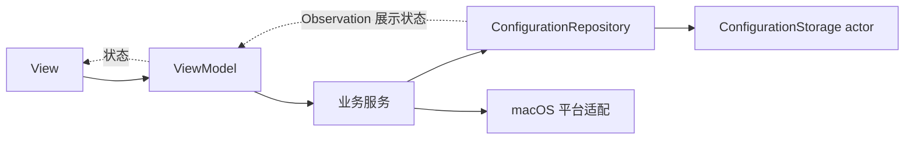

# PhrasePerch 架构

PhrasePerch 使用按功能组织的 MVVM。SwiftUI 渲染主窗口，AppKit 管理原生窗口、径向菜单和授权拖拽卡片。配置由唯一 Repository 持有，界面通过 ViewModel 发起操作。

## 职责与依赖

| 层 | 职责 | 依赖边界 |
| --- | --- | --- |
| `App` | 依赖组装、启动与退出、连接窗口入口 | `AppDependencies` 创建并持有共享实例；`ApplicationCoordinator` 连接生命周期 |
| `Domain` | Codable 数据、校验规则、触发与授权状态机 | 业务规则使用值类型；配置使用版本 2，兼容版本 1 文案配置 |
| `Features` | View、ViewModel、组件、布局与动画 | View 展示数据并调用操作入口；ViewModel 管理展示状态并调用服务 |
| `Services` | 编辑、偏好、权限、触发会话、内容插入 | 服务依赖 Repository 和平台接口；窗口交互通过 presentation 协议连接 |
| `Persistence` | 配置状态、自动保存、JSON、备份、入口偏好 | Repository 持有唯一可变配置；文件 I/O 隔离在 actor 中 |
| `Platform/macOS` | AX、剪贴板、粘贴事件、文件选择、系统监控、Dock、菜单栏、登录启动 | 封装原生系统能力与窗口外部交互 |
| `Shared` | 复用界面组件和样式 | 接收展示数据、Binding 和操作闭包 |

独立组件与主要类型分别使用同名文件。功能组件位于所属功能目录，已存在跨功能复用的组件位于 `Shared`。

## 窗口模块

- **主窗口**：`MainWindowController` 复用同一个窗口；`MainWindowViewModel` 保存导航、应用选择和每个应用的编辑会话。编辑与设置分别由 `ProfileEditorViewModel`、`PreferencesViewModel` 处理。
- **运行时菜单**：`FloatingMenuWindowController` 管理非激活面板；`FloatingMenuViewModel` 保存展示会话与选中状态。`TriggerSessionService` 通过 `FloatingMenuPresenting` 请求展示、查询选中项和收起。
- **授权拖拽卡片**：`AuthorizationGuideWindowController` 管理非激活面板，按窗口 ID 跟随系统设置主窗口，优先在外侧摆放；手动移动后在本次展示中保留位置。授权服务通过 `AuthorizationGuidePresenting` 连接卡片。
- **权限设置引导**：`PermissionSetupWindowController` 管理普通设置窗口，`PermissionSetupViewModel` 从授权服务读取统一的 `PermissionRequirement` 列表并转发操作。列表区分已授权、待授权、待生效、需修复和无需授权状态；当前展示辅助功能，后续权限通过同一列表接入。

窗口控制器由组装层持有。主窗口关闭后，运行时事件监控继续工作；重新打开主窗口保留编辑会话。

`AppEntryService` 将本机后台入口偏好与主窗口打开状态合并，统一决定 Dock 策略：主窗口打开或后台 Dock 偏好开启时使用 regular，关闭窗口后按后台偏好恢复。最小化和切换应用保留打开状态；`ApplicationCoordinator` 在打开窗口前更新入口服务，窗口关闭通过组装层回调通知服务。策略切换失败时保留可用菜单栏入口并展示反馈，窗口生命周期变化保留用户偏好。

菜单栏按钮左键复用并激活主窗口，右键弹出操作菜单。启动入口检查系统启动 Apple event 中的登录标记，`ApplicationCoordinator.start(launchedAtLogin:)` 仅在登录启动且开启静默启动时保持后台运行；手动启动、重复打开和授权重启显示主窗口。静默启动默认开启，与 Dock、菜单栏偏好一起保存在可注入的 UserDefaults 中。

权限引导在每次进程的首次手动打开主窗口时按需展示；登录启动将该检查留给首次手动打开。关闭、最小化恢复及重复打开窗口保留本次已检查标记。运行期间继续刷新权限状态，设置页可手动打开引导；引导窗口可见期间定时刷新，回到应用时立即刷新。

## 编辑与保存

文本控件的 Binding setter 调用 ViewModel，ViewModel 调用 `ProfileEditingService` 按应用 ID、文案 ID 修改配置。应用、文案和偏好修改都进入 `ConfigurationRepository.update`，Repository 对配置变更执行校验、递增修订号并通知独立订阅者。

有效配置使用 400 毫秒防抖保存；未补全的文案保留在内存，补齐后继续保存。字段校验提示和文件操作错误分别展示。异步保存结果只更新对应修订的状态。

`ConfigurationStorage` 是异步持久化接口，生产实现为 `JSONConfigurationStorage` actor。它保留原子写盘、有效备份、损坏文件保留和恢复规则。AX 引用同样保留在 `AccessibilityInputWorker` actor 内。

原生标题与正文控件按文案 ID 区分生命周期，保持 first responder 编辑菜单、输入法、选区与撤销隔离。

## 动画

`FloatingMenuAnimator` 只处理图层变换、透明度与完成通知。`FloatingMenuAnimationConfiguration` 集中定义时长、曲线和收缩比例，`AnimationScheduling` 提供可注入调度器。

按钮与一条 0.5 点、白色 4.5% 不透明度的圆线共用内容容器。默认展开 0.42 秒：整体从 24% 大小、逆时针 55° 旋出，在 69% 时间恢复正常大小和朝向，在 84% 时间顺时针轻转 3°、放大至 101.5%，随后停稳。收起从当前呈现状态在 0.12 秒内缩回触发点；减少动态效果时仅作 0.08 秒淡入淡出。命中检测将指针通过容器呈现变换的逆变换映射到按钮圆角边界。窗口绘制范围覆盖旋转包络，最终槽位与分页容量保持不变。动画和菜单展示分别检查当前会话，过期完成回调不会影响新菜单。调优从动画配置和动画实现入手。

## 测试与扩展

测试按 `Domain`、`ViewModels`、`Services`、`Persistence`、`Presentation` 分类；测试替身、预览输出和显式桌面检查入口位于 `Support`。ViewModel 测试使用临时配置或注入存储，动画测试使用手动调度器。

增加功能时，先在所属功能目录定义状态与操作入口，再接入已有服务。新增系统能力通过平台适配接口注入。配置订阅使用 token 注册与注销，功能持有者在结束生命周期时调用 `stop()`。

默认 XCTest 离屏渲染；可见原生检查在 Test Scheme 中设置 `PHRASEPERCH_VISIBLE_UI_TESTS=1`，并让 Test Action 使用自己的环境变量。UI 验证尺寸为 880 × 560、960 × 620、1070 × 620、1280 × 800。

## 交互会话与输入目标

`TriggerSessionService` 统一管理 Option 按住和组合快捷键常驻会话。`TriggerEventSource` 与 `TriggerEnvironment` 注入事件、前台应用、屏幕及等待能力；重复事件和异步完成通过会话 ID 校验。鼠标位置用于菜单定位，焦点用于确定输入目标。

`AccessibilityInputWorker` 在 actor 中保存 AX 引用，`AccessibilityAccess` 封装可注入的系统调用。捕获区分权限、安全输入、目标变化与 AX 错误；同步消息超时为 100 ms，暂时通信失败最多重试一次。会话在 500 ms 到期时取消界面等待，系统调用仍以自身超时结束，迟到结果被丢弃。

Safari 和 ChatGPT 的粘贴适配集中在 `TextInputEligibility`：普通文本角色和稳定选区通过核验后，再检查 AXValue 可写能力或指向当前编辑节点的 AXEditableAncestor。AX 选区可赋值与正文可编辑分别判断；未知位置进入仅复制模式。AXObserver 注册焦点、选区和销毁通知；提交时重新验证原目标。光标缓存只在观察有效、选区、可见文字范围和输入框几何均一致时使用。目标快照保留屏幕标识及定位来源。

WebKit 的属性与可写性实现参考[上游 Accessibility 实现](https://github.com/WebKit/WebKit/blob/main/Source/WebCore/accessibility/mac/WebAccessibilityObjectWrapperMac.mm)。实际应用暴露的属性仍需逐版本验收。

`FloatingMenuPresenting` 提供触发模式、标题字符上限、选择、关闭和失败提示。运行时 `RadialNode` 以动作枚举区分内容、分组、上一页和下一页；视图统一渲染节点，内容动作携带原条目 ID。`RadialPage` 负责顺序分页和包含空位的槽位序列，每圈最多八槽；上一页恢复访问栈中的上一张轮盘。导航后清空选择并重新要求鼠标移动。两种触发模式共用插入流程，单次会话最多提交一次。展开、插入和复制成功时只更新诊断；失败及待核验结果在鼠标下方显示非激活提示框。

`InteractionDiagnostics` 保存最近 20 次会话的阶段、耗时、定位来源和结果，供设置页展示。插入结果在最长一秒内读回核验，无法确认时由用户检查，避免重复发送。

配置格式为版本 2，版本 1 文案与偏好自动解码为当前结构，首次保存前备份原文件。`AppDependencies` 通过 `ApplicationCatalog` 解析本机 Safari 和 ChatGPT 身份并注入首次配置；JSON actor 仅在文件缺失时原子创建。配置损坏走错误与恢复流程。`both` 表示两个入口均可使用。

`MenuNode` 引用文案或分组，`SnippetGroup.children` 与根级节点列表表示顺序和唯一归属。文案仍保留在原 `buttons` 集合，编辑及插入通过 ID 定位。层级验证检查重复引用、缺失对象、循环和未归属节点。复制应用规则时同时重建所有节点 ID 和引用。

菜单控制器维护导航栈、每层页面和页码；分组、下一页及上一页悬停 180 ms 后导航。运行时与编辑预览共用 `CircularButtonLayout`，基准槽位在共同圆周上，变宽后重新核对至少 12 点的按钮间距与中心安全区。左右按钮固定内侧边向外增长，上下中线按钮对称加宽。屏幕边缘整体平移。上一页与下一页同时出现时使用偶数槽并严格相隔 180°；导航仍以所选节点为新轮盘期望中心，上一页朝向进入方向的反面。

按钮最小尺寸为 88 × 40 点，标题按全局字符上限格式化并测量各自宽度。屏幕空间不足时先减少页容量，再降低当前页实际显示字符数；无障碍名称保留完整标题。上一页恢复历史内容、页码及槽位分配，并以当前上一页节点为期望中心重新定位；若仍有上一页，按本次进入方向重新定位其朝向，返回根页则恢复顶部起始。边界整体平移，无法容纳时保留当前页并提示。空槽不参与显示、命中和无障碍访问。导航、翻页与动画使用展示代次丢弃过期回调；只有内容 ID 可以进入提交路径。

配置使用版本 2。旧文件的 `menuExpansionMode` 作为已停用字段忽略，新保存及导出文件省略该字段；既有偏好字段保持严格解码，标题字符上限缺省为 10，并校验 1–30 的范围。授权拖拽卡片按系统设置窗口右侧下方区域定位，中心位于窗口横向 66%、从顶部向下 80% 处；窗口识别、移动、缩放和切屏后重新计算，卡片约束在窗口与屏幕可见区域内。

目标快照包含焦点分类、粘贴能力和直接写入能力。明确无焦点可打开复制轮盘，提交前核验应用及焦点；查询失败保留 AX 原因。`copyOnInsert` 默认开启，关闭后通过 `AccessibilityAccess.replaceSelection` 写入 `AXSelectedText`；直接写入与粘贴共享操作门、原目标与选区验证和读回预算。AX 写入可能超时后仍被编辑器接受，因此开始调用即标记可能写入，失败也不重发。

应用标识统一为 `local.PhrasePerch`；主窗口新建时内容区为 1070 × 620 点。文案行使用完整选择命中区域，行尾控件独立响应。

## 附件存储与完整备份

`SnippetContent` 表达文案和单文件附件，`AttachmentReference` 保存资源 ID、原文件名与字节数。`JSONConfigurationStorage` 在同一 actor 内管理 JSON、附件副本及导入暂存；添加和替换先复制文件，成功后由编辑服务更新引用。复制条目和应用规则共享附件资源。资源回收检查当前磁盘与内存配置、保留备份、剪贴板文件 URL、未提交副本和操作租约；引用无法确认时保留文件。

内容列表接收本地文件 URL 拖拽，与工具栏共用 `ProfileEditorViewModel.addAttachments(from:)`。一次导入固定应用与分组，按顺序逐文件添加，以完整文件名创建标题；部分失败保留成功项并展示失败文件。切换分组保留当前导航，目标被删除时由编辑服务释放本次未提交资源。

`.phraseperch` 是系统注册的文件包，包含 `configuration.json` 和 `attachments/`。导出暂存当前配置及被引用的资源，再替换目标；导入校验普通文件、文件名、资源信息和目录符号链接，为资源分配新 ID，确认后提交。失败清理本次暂存及新增副本，保留原配置与附件。含附件引用的配置通过完整备份包导入。

`ContentInsertionService` 统一操作门与取消保护。文案沿用剪贴板或 AX 直接写入及正文读回；附件先取得文件租约，在后台准备剪贴板载荷，再核验原焦点、选区、权限和剪贴板代次，发送一次粘贴。一个剪贴板条目提供文件 URL 和可用的原始图像表示。附件结果报告已复制或粘贴已发送。操作结束释放租约，剪贴板引用继续保护文件。

`Preferences.menuTitleCharacterLimit` 控制 1–30 个 Swift Character，默认 10；换行和制表符折叠为空格，导航标签完整显示。页面记录每个槽位宽度和实际字符上限，绘制与命中使用同一组边界。`FloatingMenuAnimator` 的方向参数镜像返回时的旋转关键帧；前进方向、420 ms 展开、120 ms 收起和减少动态效果下的 80 ms 淡入淡出保持一致。
